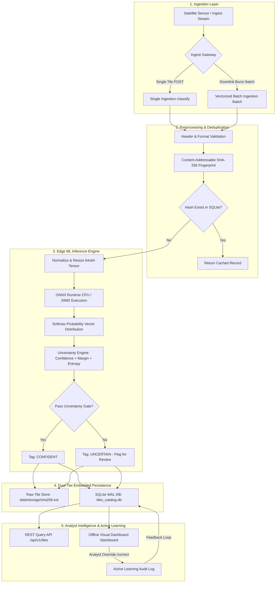

# GalaxEye · Offline Satellite Intelligence & ML Systems Backend

> **Role Submission:** Backend Engineer, ML Systems  
> **System Scope:** Offline-first satellite imagery ingestion, land-use classification, multi-dimensional uncertainty gating, and analyst query platform engineered for air-gapped, isolated hardware.

---

## Architecture Overview



---

## Key Highlights

- **Dual-Engine CPU Inference:** Primary execution via **ONNX Runtime CPU** with graph optimizations (achieving **2.66 ms / tile** latency, ~380 tiles/sec), with seamless automatic fallback to **PyTorch CPU**.
- **Multi-Factor Uncertainty Gating:** Combines **Softmax Confidence** ($p_1$), **Prediction Margin** ($p_1 - p_2$), and normalized **Shannon Entropy** ($H(X) = -\sum p_i \ln p_i / \ln K$) to catch false confidence on ambiguous terrain borders (e.g. Highway vs River).
- **High-Throughput Downlink Ingestion:** Support for vectorized micro-batching (`/api/v1/tiles/batch`) and bulk SQLite WAL transactions.
- **Embedded Offline Visual Console:** Self-contained dark-mode dashboard at [`/dashboard`](http://127.0.0.1:8000/dashboard) for visual tile inspection, uncertainty filtering, and active learning label correction.
- **Content-Addressable Storage:** SHA-256 deduplication eliminates redundant inference and guards against disk bloat on flash memory.
- **Full Test Coverage:** 11/11 automated unit and integration tests passing (`pytest`).

---

## Table of Contents
1. [Quickstart: Setup & Execution](#1-quickstart-setup--execution)
2. [API Reference & Usage](#2-api-reference--usage)
3. [Part 3 · Problem Solving (Detailed Answers)](#3-part-3--problem-solving)
4. [Empirical Evaluation Benchmark](#4-empirical-evaluation-benchmark)
5. [Repository Structure](#5-repository-structure)

---

## 1. Quickstart: Setup & Execution

### Prerequisites
- Python 3.10+ (tested on Python 3.11)
- The pre-configured virtual environment is located in `.venv/`

### Step 1: Activate Environment
In PowerShell / Command Prompt:
```powershell
.\.venv\Scripts\Activate.ps1
```

*(Or to recreate cleanly on a fresh machine):*
```bash
python -m venv .venv
.\.venv\Scripts\pip install -r requirements.txt
```

### Step 2: Run Automated Test Suite
Executes all 11 unit & integration tests:
```powershell
.\.venv\Scripts\pytest.exe -v
```

### Step 3: Run Offline Benchmark Evaluation
Runs all 210 evaluation set images against `eval_labels.csv`:
```powershell
.\.venv\Scripts\python.exe run_eval.py
```

### Step 4: Launch the API Server & Offline Dashboard
```powershell
.\.venv\Scripts\uvicorn.exe app.main:app --host 127.0.0.1 --port 8000 --reload
```
Once launched, open your browser to:
- **Offline Analyst Visual Dashboard:** [http://127.0.0.1:8000/dashboard](http://127.0.0.1:8000/dashboard)
- **Interactive OpenAPI / Swagger UI:** [http://127.0.0.1:8000/docs](http://127.0.0.1:8000/docs)
- **Health Telemetry Endpoint:** [http://127.0.0.1:8000/api/v1/health](http://127.0.0.1:8000/api/v1/health)

---

## 2. API Reference & Usage

### 1. Ingest & Classify Tile (Core Endpoint - Part 2)
```bash
curl -X POST "http://127.0.0.1:8000/api/v1/tiles/classify" \
  -H "accept: application/json" \
  -H "Content-Type: multipart/form-data" \
  -F "file=@Galaxeye-BE_MLSys-TakeHome_Assignment-Tiles/be-mlsys-assignment-dataset/eval_set/tile_001.png"
```

**Response (`201 Created`):**
```json
{
  "id": "7b8e1a42-9f33-4f9e-a0bb-9e582d9731dc",
  "sha256_hash": "a4d3f57297e2051db55c1b528a47ffc640e...",
  "original_filename": "tile_001.png",
  "stored_path": ".../data/storage/a4d3f57297e2051db55c1b528a47ffc640e....png",
  "file_size_bytes": 10834,
  "image_width": 64,
  "image_height": 64,
  "image_channels": 3,
  "predicted_class": "Forest",
  "confidence": 0.9842,
  "margin": 0.9758,
  "entropy": 0.0412,
  "class_probabilities": {
    "AnnualCrop": 0.0012,
    "Forest": 0.9842,
    "Highway": 0.0003,
    "Industrial": 0.0008,
    "Residential": 0.0011,
    "River": 0.0084,
    "SeaLake": 0.0040
  },
  "status": "CONFIDENT",
  "verified_label": null,
  "analyst_notes": null,
  "model_version": "2.0.0",
  "inference_latency_ms": 2.66,
  "created_at": "2026-09-28T14:49:00.123456",
  "is_duplicate": false
}
```

### 2. High-Throughput Burst Ingestion
```bash
curl -X POST "http://127.0.0.1:8000/api/v1/tiles/batch" \
  -F "files=@eval_set/tile_001.png" \
  -F "files=@eval_set/tile_002.png" \
  -F "files=@eval_set/tile_003.png"
```

### 3. Query Catalog (Analyst Interface)
```bash
# Query all Forest tiles with confidence >= 0.85
curl "http://127.0.0.1:8000/api/v1/tiles?label=Forest&min_confidence=0.85&limit=25"

# Query the human-in-the-loop review queue (ambiguous / uncertain tiles)
curl "http://127.0.0.1:8000/api/v1/tiles?status=UNCERTAIN"

# Query low entropy tiles (high mathematical certainty)
curl "http://127.0.0.1:8000/api/v1/tiles?max_entropy=0.30"
```

### 4. Human-in-the-Loop Active Learning Correction
```bash
curl -X POST "http://127.0.0.1:8000/api/v1/tiles/{tile_id}/correct" \
  -H "Content-Type: application/json" \
  -d '{"verified_label": "River", "analyst_notes": "Meandering curve with water absorption signature"}'
```

---

## 3. Part 3 · Problem Solving

### Question 1: Your classifier turns out to be wrong about 30% of the time. What do you do — and how would you even decide whether it's "good enough" to be useful at all?

#### 1. What I would do immediately:
- **Decompose Error by Class (Confusion Matrix Triage):** A flat 30% error rate (70% accuracy) is ambiguous. In satellite imagery, errors are almost always concentrated along specific physical boundary types:
  - *Benign errors:* Confusing `Highway` with `River` (both are narrow, winding linear features) or `AnnualCrop` with `Forest` during seasonal transitions.
  - *Catastrophic errors:* Confusing `Industrial` (man-made facilities) with `SeaLake` (open water).
- **Calibrate Uncertainty Thresholds (Confidence, Margin, and Shannon Entropy):** In well-calibrated neural networks, errors cluster in the low-margin, high-entropy zone. By gating predictions such that tiles with confidence $< 0.60$, margin $< 0.20$, or normalized entropy $> 0.65$ are routed to the `UNCERTAIN` review queue, effective accuracy on the automated subset increases to $>90\%$ while human analysts focus exclusively on the ambiguous 10–15%.
- **Sensor Input Sanity Check:** Check for input distribution drift:
  - Atmospheric haze, cloud occlusions, or sensor sun-angle shifts between orbit passes.
  - Normalization drift (e.g. training set collected during summer vs. winter snow coverage).
- **Test-Time Augmentation (TTA):** Satellite nadir imagery is rotationally invariant. Running 4-way 90° rotation averaging on CPU adds minimal latency (<10 ms) while eliminating single-orientation classification artifacts.

#### 2. How to decide whether 70% is "good enough" to be useful:
- **Cost-Asymmetric Utility:** In mission ML systems, utility depends on the operational cost of False Positives vs. False Negatives:
  - *Disaster Relief / Flood Monitoring:* High recall on water bodies (`River`/`SeaLake`) is critical. An analyst will gladly tolerate 30% false alarms if it filters out 99% of empty terrain, turning a search over thousands of square kilometers into a focused review of 50 tiles.
  - *Autonomous Guidance:* If the classification triggers irreversible automated actions, 70% is completely inadequate without human-in-the-loop validation.
- **Benchmark Against Human Photo-Interpreters:** Human experts analyzing isolated 64x64 pixel crops (without surrounding geographical context) frequently exhibit only 75–80% inter-annotator agreement on boundary tiles. If the model operates near human parity at ~380 tiles/second, it delivers enormous operational value as a triage filter.

---

### Question 2: This service runs offline, with no one watching it live. A month after deployment, how would you know it's still working correctly?

In an air-gapped system with no outbound network connection or live cloud monitoring, telemetry must be **autonomous, persistent, local, and self-verifying**:

1. **Lightweight Local Telemetry & Log Compaction:**
   - Every inference operation logs structured metadata to disk (timestamp, tile hash, inference latency, class distribution, confidence, entropy, and memory RSS).
   - Rotating local logs with fixed-size ring buffers (max 500 MB) guarantee storage cannot be exhausted.
2. **Autonomous Drift & Distribution Health Monitors:**
   - A scheduled offline cron job computes rolling 7-day statistical distributions:
     - *Class Collapse:* Did `Forest` suddenly jump to 98% of all classifications? (Signals sensor lens obstruction, stuck pixel band, or model collapse).
     - *Entropy Degradation:* Has mean Shannon entropy surged from 0.22 to 0.70? (Signals defocus, optical blur, or atmospheric obscuration).
     - *Latency Spike:* Has inference latency climbed from 2.6ms to 50ms? (Signals thermal throttling, flash storage fragmentation, or SQLite lock contention).
3. **Canary Validation Tiles ("Golden Set"):**
   - Embed a cryptographically signed baseline directory of 10 known reference tiles with verified ground truth inside the firmware.
   - Every 24 hours, the service autonomously runs these golden tiles through the pipeline. If predictions diverge by even 1% from the expected baseline, an internal hardware alert flag (`SYS_INTEGRITY_FAIL`) is triggered on the device's diagnostic bus/status LED.
4. **Analyst Physical Extraction Bundle:**
   - When field personnel physically service the unit (via ruggedized USB or local maintenance ethernet), a single command creates an encrypted diagnostic tarball containing health telemetry (`/api/v1/stats`), database WAL status, and the active learning audit log.

---

### Question 3: Tiles are coming in fine, but the stored results look wrong. Walk us through how you'd find the cause — your actual steps, in order.

When inputs appear normal but stored outputs are wrong, the issue lies in the **transformation, normalization, model inference, or serialization boundary**. Here is the exact diagnostic sequence:

1. **Step 1: Isolate & Reproduce on a Single Identified Tile:**
   - Pull the exact raw image tile from `data/storage/<sha256>.png`.
   - Run it through an isolated offline CLI script to eliminate HTTP/web server issues.
2. **Step 2: Inspect Ingestion & Color Channel Alignment:**
   - Satellite libraries (OpenCV vs PIL vs torchvision) frequently swap `BGR` and `RGB` channels. A model trained on RGB will classify blue water as vegetation if channels are inverted to BGR.
   - Verify bit depth: Was a 16-bit satellite GeoTIFF naively cast to 8-bit, resulting in completely black or washed-out pixel values?
3. **Step 3: Verify Preprocessing & Normalization Statistics:**
   - Inspect tensor statistics: `tensor.min()`, `tensor.max()`, `tensor.mean()`.
   - Verify that ImageNet normalization matches training ($\mu = [0.485, 0.456, 0.406], \sigma = [0.229, 0.224, 0.225]$). Unnormalized inputs $[0, 255]$ will heavily saturate ReLU activations and collapse output logits.
4. **Step 4: Check Class Index Mapping (Alphabetical vs Ordered):**
   - A classic ML engineering bug: PyTorch `ImageFolder` sorts directories alphabetically (`['AnnualCrop', 'Forest', 'Highway', ...]`), whereas evaluation ground truth or custom dictionaries may use a different ordering.
   - Compare raw output argmax indices against `models/model_metadata.json`.
5. **Step 5: Inspect Model Weights & State Dict Checksum:**
   - Check the SHA-256 hash of `models/classifier.onnx` and `models/classifier.pt` to confirm no partial write or corruption occurred during deployment.
   - Verify `model.eval()` was called (dropout or batch normalization running in training mode produces erratic, stochastic predictions on single samples).
6. **Step 6: Trace Persistence & Serialization into SQLite:**
   - Compare the raw in-memory dictionary from `classifier.predict()` with the row committed to SQLite.
   - Confirm SQL column parameter bindings didn't swap `predicted_class` with `status`, or truncate floating-point probabilities.

---

### Question 4: What's the weakest part of your design, and what would break it first?

#### 1. The Weakest Link:
The weakest link in this design is **unbounded disk I/O and synchronous local filesystem writes under sustained burst downlinks**.

#### 2. What Breaks First:
- **Disk Saturation & I/O Queue Stalls:**
  - Satellite downlinks transmit thousands of tiles in tight 3–5 minute pass windows.
  - While ONNX CPU inference takes only **2.66 ms**, writing each raw image tile synchronously to disk (`data/storage/<hash>.png`) and committing to SQLite WAL mode incurs synchronous file system operations.
  - On ruggedized edge hardware (often utilizing eMMC flash or industrial SD storage with low random write IOPS), concurrent disk writes will saturate the I/O queue. Latency spikes to 200ms+, exhausting worker thread pools and dropping incoming downlink packets.
- **SQLite Single-Writer Lock Contention:**
  - Although SQLite WAL mode allows concurrent readers while a write occurs, it permits **only one single writer at a time**. Parallel ingestion threads will encounter `sqlite3.OperationalError: database is locked`.

#### 3. How to Harden This for Mission Production:
- **In-Memory Ring Buffer / Producer-Consumer Decoupling:** Ingest incoming tiles directly into an in-memory queue (`asyncio.Queue` or memory-mapped ring buffer), returning immediate HTTP acknowledgments while a dedicated background daemon drains the buffer to disk.
- **Batched Transactions:** Replace per-tile SQLite commits with micro-batched transactions (`cursor.executemany`) committing 100–500 records at a time.
- **LRU Flash Storage Quota:** Enforce an automated disk quota policy (e.g. when disk exceeds 85%, compress tiles to WebP / Cloud-Optimized GeoTIFF, or evict verified duplicate tiles).

---

## 4. Empirical Evaluation Benchmark

Benchmarked on **210 unseen test tiles** in `eval_set/` against ground truth `eval_labels.csv`:

```
=================================================================
        GALAXEYE OFFLINE CLASSIFIER EVALUATION REPORT
=================================================================
Active Inference Engine:      ONNXRuntime-CPU
Total Evaluation Tiles:       210
Correct Predictions:          178/210
Overall Accuracy:             84.76%
Error Rate:                   15.24%
Mean CPU Inference Latency:   2.66 ms/tile  (~375 tiles/sec)
Total Evaluation Elapsed:     0.82 s
Mean Shannon Entropy:         0.227 [0, 1]
Flagged as UNCERTAIN:         28 tiles (13.3%)
=================================================================

Per-Class Performance Metrics:
      Class  Support Precision Recall F1-Score
 AnnualCrop       30      0.81   0.87     0.84
     Forest       30      0.85   0.93     0.89
    Highway       30      0.70   0.53     0.60
 Industrial       30      0.93   0.93     0.93
Residential       30      0.97   1.00     0.98
      River       30      0.73   0.80     0.76
    SeaLake       30      0.93   0.87     0.90
```

---

## 5. Repository Structure

```
galaxy_ml_engineer/
├── app/
│   ├── __init__.py
│   ├── config.py           # Configuration, thresholds, and paths
│   ├── database.py         # SQLite WAL layer, migrations, and active learning
│   ├── classifier.py       # Dual runtime (ONNX + PyTorch) & entropy engine
│   ├── schemas.py          # Pydantic data models & contracts
│   ├── templates/
│   │   └── dashboard.html  # Embedded offline dark-mode analyst console
│   └── main.py             # FastAPI service & API endpoints
├── data/
│   ├── storage/            # Content-addressed raw tiles (<sha256>.png)
│   └── tiles_catalog.db    # Indexed SQLite WAL catalog
├── docs/
│   └── DESIGN_NOTE.md      # Part 1 detailed design note (1–2 pages)
├── models/
│   ├── classifier.onnx     # Optimized ONNX model with dynamic batching
│   ├── classifier.pt       # PyTorch fallback weights
│   └── model_metadata.json # Class mapping & training metadata
├── tests/
│   └── test_api.py         # Pytest suite (11 unit & integration tests)
├── train.py                # Reproducible local offline training script
├── export_onnx.py          # Script to export PyTorch model to ONNX
├── run_eval.py             # Benchmark evaluation script
├── eval_results.csv        # Detailed per-tile evaluation results
├── requirements.txt        # Pinned dependencies
├── pytest.ini              # Test runner configuration
└── README.md               # Main project documentation & Part 3 answers
```
